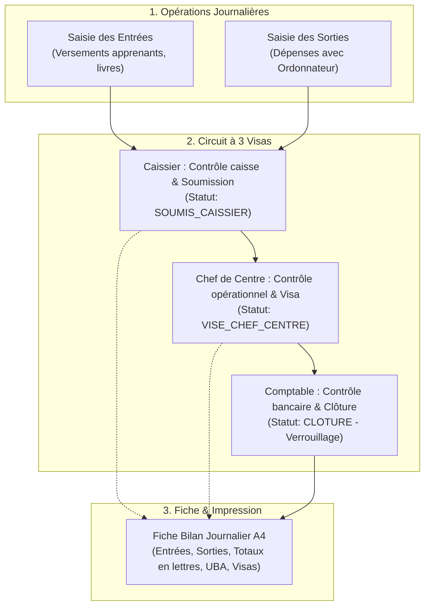

# Plan d'implémentation : Bilan Journalier & Gestion des Sorties (Fiche Officielle EXCELIS PREPAS)

Ce document détaille la conception et l'implémentation du sous-système complet de **Bilan Journalier et Clôture de Caisse** pour EXCELIS PREPAS, incluant la gestion des **Sorties** avec ordonnateurs et validateurs, le cycle d'approbation à **3 Visas** (Caissier ➔ Chef de Centre ➔ Comptable), et la génération d'une **Fiche de Bilan Journalier imprimable/exportable** fidèle à la maquette physique officielle.

---

## 1. Description de l'objectif & Contexte

### Contexte & Problématique
EXCELIS PREPAS utilise une fiche papier de clôture journalière (*Fiche de Bilan Journalier*, réf. `YA/__/__/2026`) regroupant les données opérationnelles du jour, les encaissements ventilés par formation, les coordonnées bancaires UBA et 3 visas hiérarchiques. 
Actuellement :
1. Le backend possède un début de modèle pour `BilanJournalier`, `Entree` et `Sortie`, mais le statut ne gère que 2 étapes (`EN_ATTENTE_CONTROLEUR` et `CLOTURE`), sans visa intermédiaire pour le caissier.
2. Les calculs d'indicateurs de cours/salles du jour et d'effectifs dans `BilanJournalierService` étaient annotés `TODO`.
3. Le frontend ne possède pas encore la page dédiée `/bilan-journalier` (bien que le lien figure déjà dans la barre de navigation et sur les KPIs du tableau de bord Chef de Centre).
4. La gestion des **Sorties** doit comporter la saisie explicite de l'**ordonnateur** et la traçabilité du **validateur** (utilisateur connecté décaissant les fonds).
5. Aucune vue d'impression normalisée reprenant la fiche officielle physique n'est disponible.

### Résultat attendu
- Un écran de gestion interactif `/bilan-journalier` avec sélection de date et de centre.
- Prise en charge complète des **Sorties** de caisse avec motif, montant, ordonnateur et validateur.
- Un workflow d'approbation en 3 étapes :
  - **Étape 1 (Caissier)** : soumission de la caisse (`SOUMIS_CAISSIER`).
  - **Étape 2 (Chef de centre)** : visa administratif (`VISE_CHEF_CENTRE`).
  - **Étape 3 (Comptable / Contrôleur)** : visa comptable et clôture définitive (`CLOTURE`).
- Une vue d'impression haute fidélité (format A4 portrait) conforme au modèle physique :
  - En-tête EXCELIS PREPAS & indicateurs (*Réf date, Nbre Salles, Nbre Cours, Nouveaux Élèves, Effectif Total*).
  - Tableau **ENTREES** (N°, Motif, Effectif, Nom Caissier, Montant XAF, Signature).
  - Tableau **SORTIES** (N°, Motif, Montant XAF, Ordonnateur, Validateur/Caissier, Signature).
  - Totaux en chiffres et en lettres (*Total Général Entrées, Total Général Sorties, Net à verser*).
  - Encart bancaire UBA Cameroun & consigne de versement avant 15h.
  - 3 cases de Visas officielles avec horodatage et noms des signataires.

---

## 2. Décisions de conception & Validation utilisateur

> **Décisions actées lors du cadrage** :
> 1. **Sorties de caisse** : Ordonnateur saisi librement (avec suggestions de complétion pour les rôles administratifs) + Validateur tracé automatiquement depuis l'utilisateur connecté ayant enregistré l'opération.
> 2. **Circuit d'approbation à 3 visas** :
>    - Visa 1 : Caissier(s)
>    - Visa 2 : Chef(s) de centre
>    - Visa 3 : Comptable (clôture et verrouillage)
> 3. **Indicateurs d'en-tête automatiques** :
>    - *Nombre de Salles* & *Nombre de Cours* calculés automatiquement à partir des affectations/séances planifiées pour la date sélectionnée.
>    - *Effectif Nouveaux Élèves* (inscrits le jour J) & *Effectif Total Centre* (total inscrits actifs du centre) calculés depuis la base apprenants.

---

## 3. Architecture & Flux de données

---

## 4. Modifications proposées

### A. Backend Spring Boot (Clean Architecture)

#### `backend/src/main/java/com/excelisprepas/backend/financier/domain/model/StatutBilan.java`
- Ajouter les nouveaux statuts séquentiels :
  - `OUVERT`
  - `SOUMIS_CAISSIER`
  - `VISE_CHEF_CENTRE` (rétrocompatible avec `EN_ATTENTE_CONTROLEUR`)
  - `CLOTURE`

#### `backend/src/main/java/com/excelisprepas/backend/financier/domain/model/BilanJournalier.java`
- Ajouter les champs et méthodes pour :
  - `visaCaissier` : `UUID caissierId`, `String nomCaissier`, `LocalDateTime dateVisaCaissier`.
  - `visaChefCentre` : `UUID chefCentreId`, `String nomChefCentre`, `LocalDateTime dateValidationChefCentre`.
  - `visaComptable` : `UUID comptableId`, `String nomComptable`, `LocalDateTime dateValidationControleur`.
  - `int nombreSalles`, `int nombreCours`.
  - Méthodes de transition : `soumettreParCaissier(...)`, `viserParChefCentre(...)`, `cloturerParComptable(...)`.

#### `backend/src/main/java/com/excelisprepas/backend/financier/infrastructure/out/persistence/BilanJournalierEntity.java` & Persistence Mapper
- Ajouter les colonnes correspondantes :
  - `caissier_id`, `nom_caissier`, `date_visa_caissier`
  - `nom_chef_centre`, `nom_comptable`
  - `nombre_salles`, `nombre_cours`

#### `backend/src/main/java/com/excelisprepas/backend/financier/domain/model/Sortie.java`
- Garantir le stockage de l'`ordonnateur` et enrichir avec le nom/prénom du validateur (`saisiParUtilisateurNom`).

#### `backend/src/main/java/com/excelisprepas/backend/financier/domain/service/BilanJournalierService.java`
- Implémenter le calcul réel des indicateurs opérationnels :
  - `effectifNouveauxEleves` : requête de comptage sur `ApprenantRepositoryPort` par date d'inscription et centre.
  - `effectifTotalCentre` : requête de comptage sur `ApprenantRepositoryPort` par centre et session.
  - `nombreSalles` & `nombreCours` : requête sur les affectations planifiées pour la date (calcul du jour de la semaine et de la semaine de session).
- Mettre en place les 3 cas d'utilisation de visa :
  - `SoumettreBilanCaissierUseCase`
  - `ValiderBilanChefCentreUseCase`
  - `ValiderBilanControleurUseCase`

#### `backend/src/main/java/com/excelisprepas/backend/financier/infrastructure/in/web/BilanJournalierController.java` & DTOs
- Ajouter `POST /api/bilans-journaliers/soumettre-caissier` (rôle CAISSIER / CHEF_CENTRE).
- Mettre à jour `POST /api/bilans-journaliers/valider-chef-centre` (rôle CHEF_CENTRE / DIRECTEUR).
- Mettre à jour `PATCH /api/bilans-journaliers/{id}/valider-controleur` (rôle COMPTABLE / CONTROLEUR / DIRECTEUR).
- Enrichir `BilanJournalierResponse` et `BilanApercuResponse` avec les visas et les métadonnées (nombreSalles, nombreCours).

---

### B. Frontend Next.js / TypeScript

#### `frontend/src/shared/lib/nombre-en-lettres.ts`
- Fonction utilitaire `nombreEnLettres(montant: number): string` convertissant fidèlement un montant numérique en lettres en français (avec gestion des centaines, milliers, millions et ajout de `francs CFA`).

#### `frontend/src/modules/financier/domain/types.ts`
- Enrichir `BilanApercu` et `BilanJournalier` avec les informations de visas (`nomCaissier`, `dateVisaCaissier`, etc.), `nombreSalles` et `nombreCours`.
- Enrichir le type `Sortie` avec `ordonnateur` et `saisiParNom`.

#### `frontend/src/modules/financier/data/client.ts` & `queries.ts`
- Ajouter les fonctions clients d'API :
  - `saisirSortie(input: SaisirSortieInput)`
  - `soumettreBilanCaissier(bilanId, ...)`
  - `viserBilanChefCentre(bilanId, ...)`
  - `cloturerBilanComptable(bilanId, ...)`
- Hooks React Query correspondants avec invalidation optimisée du cache.

#### `frontend/src/modules/financier/components/SaisirSortieModal.tsx`
- Modale pour enregistrer un décaissement du jour :
  - Sélection du motif (type `SORTIE` filtré depuis la liste des motifs).
  - Montant (FCFA).
  - Champ **Ordonnateur** (avec autocomplétion ou suggestions du personnel administratif).
  - Validation automatique de l'agent connecté comme validateur.

#### `frontend/src/modules/financier/components/FicheBilanPrintModal.tsx`
- Composant modal et vue d'impression `@media print` répliquant fidèlement la fiche papier fournie :
  - **En-tête officiel** : Logo EXCELIS PREPAS, titre *"FICHE DE BILAN JOURNALIER"*, bloc référence (`YA/JJ/MM/AAAA`), indicateurs en tableau (Salles, Cours, Nouveaux Élèves, Effectif total Centre).
  - **Section ENTRÉES** : Tableau avec colonnes *N°*, *Motif (ING., AHN/IAI, Santé & Agro...)*, *Effectifs*, *Nom Caissier*, *Montant (en XAF)*, *Signature*.
  - **Section SORTIES** : Tableau miroir avec colonnes *N°*, *Motif de la dépense*, *Montant (en XAF)*, *Ordonnateur*, *Validateur / Caissier*, *Signature*.
  - **Totaux & Versements** : Total Général entrées (chiffres & lettres), Total Général sorties (chiffres & lettres), Net à verser (chiffres & lettres).
  - **Encart bancaire** : UBA Cameroon, Compte Abega Flore Ernestine, code banque, règle de versement avant 15H.
  - **Pied de page / Visas** : 3 cadres distincts (*Visa Caissier(s)*, *Visa Directeur(s) de centre*, *Visa Comptable*) affichant le statut du visa, le nom du signataire, l'horodatage ou la signature.

#### `frontend/src/app/(dashboard)/bilan-journalier/page.tsx` & `BilanJournalierView.tsx`
- Écran principal de gestion du bilan journalier :
  - Barre d'outils supérieure : sélecteur de date (calendrier avec raccourcis Jour précédent / Aujourd'hui / Jour suivant) et sélecteur de centre (si profil multi-centres).
  - Barre d'état du workflow de clôture (Indicateur visuel étape par étape : Ouvert ➔ Soumis Caissier ➔ Visé Chef de centre ➔ Clôturé).
  - Boutons d'action contextuels :
    - "Nouvelle Entrée" (ouvre `EnregistrerVersementModal`)
    - "Nouvelle Sortie" (ouvre `SaisirSortieModal`)
    - "Apposer mon Visa" / "Clôturer le bilan" selon le rôle de l'utilisateur.
    - "Imprimer la Fiche de bilan" (ouvre `FicheBilanPrintModal`).
  - Tableaux interactifs des entrées et des sorties du jour avec totaux calculés en direct.

---

## 5. Plan de vérification

### Tests automatisés
1. **Backend Tests** :
   - Tests unitaires sur les règles métier de `BilanJournalier` (transitions d'états, verrouillage des modifications une fois clôturé).
   - Test du service `BilanJournalierService` pour le calcul des totaux et indicateurs.
   - Test d'intégration sur `BilanJournalierController` et `MouvementFinancierController` (`saisirSortie`).
   - Commande : `./mvnw test -Dtest=BilanJournalier*Test,MouvementFinancier*Test`
2. **Frontend TypeCheck & Lint** :
   - Vérification TypeScript : `pnpm typecheck`
   - Vérification ESLint : `pnpm lint`

### Tests manuels & Vérifications visuelles
1. **Saisie & Consultation** :
   - Enregistrer une entrée et une sortie avec ordonnateur sur la journée du jour.
   - Vérifier l'apparition immédiate dans le tableau interactif et la mise à jour des totaux (Entrées, Sorties, Net).
2. **Workflow des 3 Visas** :
   - Tester la soumission par le caissier ➔ passage au statut `SOUMIS_CAISSIER`.
   - Tester le visa du chef de centre ➔ passage au statut `VISE_CHEF_CENTRE`.
   - Tester le visa du comptable ➔ passage au statut `CLOTURE`.
   - Vérifier que les boutons de modification/suppression d'entrées et de sorties se désactivent lorsque le bilan est verrouillé.
3. **Impression de la Fiche A4** :
   - Cliquer sur "Imprimer la Fiche de bilan".
   - Vérifier dans l'aperçu avant impression le respect fidèle de la maquette physique (logo, proportions des tableaux, conversion exacte du montant en lettres, coordonnées UBA, 3 cadres de visas avec horodatage).
